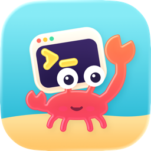
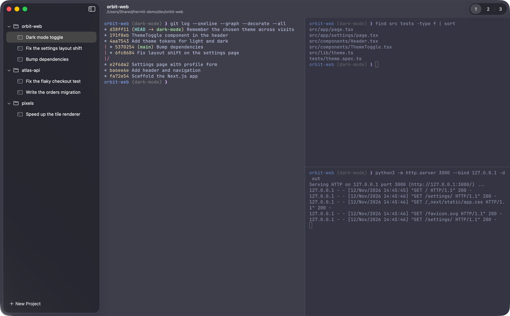
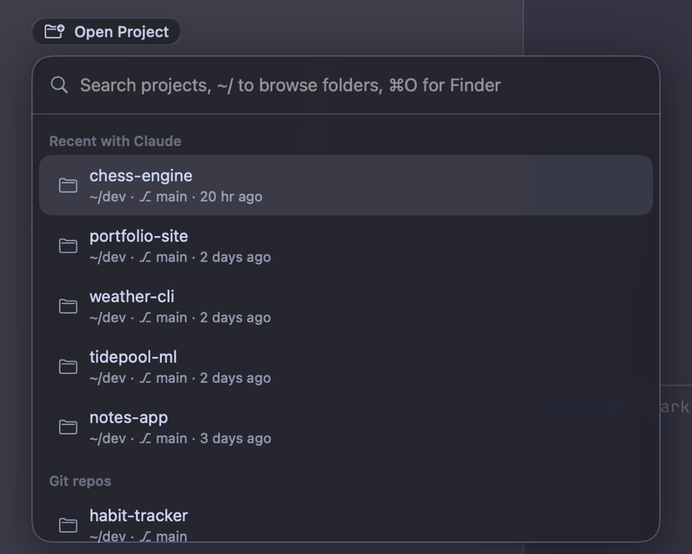

<h1 align="center">
  
  <br />
  Hermit
</h1>

<p align="center">
  <b>A Mac terminal with your projects in a sidebar, each with its own terminals and Claude Code sessions.</b><br />
  Quit any time: your shells keep running, and every tab comes back when you reopen it.
</p>

<p align="center">
  <a href="https://github.com/nishantkumar1292/hermit/releases/latest"></a>
  
  
  <a href="LICENSE"></a>
</p>

<p align="center">
  <a href="#install"><b>Install</b></a> ·
  <a href="#your-first-minute"><b>First minute</b></a> ·
  <a href="#what-hermit-adds"><b>What Hermit adds</b></a> ·
  <a href="#everything-else-comes-from-macterm"><b>Features</b></a> ·
  <a href="#credits"><b>Credits</b></a>
</p>



## Install

**One line** (Terminal, or any shell):

```bash
curl -fsSL https://raw.githubusercontent.com/nishantkumar1292/hermit/main/scripts/get.sh | bash
```

It downloads the latest release, puts `Hermit.app` in Applications and clears the download flag. Run it again to update. You can [read the script](scripts/get.sh) first: it's about 40 lines.

<details>
<summary><b>Or install by hand</b></summary>

1. Download **`Hermit.dmg`** from the [latest release](https://github.com/nishantkumar1292/hermit/releases/latest).
2. Open it and drag **Hermit** to **Applications**.
3. Hermit isn't notarized by Apple, so clear the download flag once. Without this, macOS says the app "is damaged" or "can't be checked":

   ```bash
   xattr -cr /Applications/Hermit.app
   ```

4. Open Hermit from Launchpad or Spotlight.

</details>

| You need | |
|---|---|
| macOS | 14 Sonoma or later |
| Mac | Apple Silicon or Intel (one universal app) |
| Optional | [Claude Code](https://claude.com/claude-code), for the Open Project suggestions and named tabs |

> [!NOTE]
> Hermit doesn't update itself yet. To update, run the one-liner again, or download the new `.dmg`. Quit Hermit first: your shells keep running and reattach when it starts again.

## Your first minute

| Do this | Press |
|---|---|
| Open a folder as a project | <kbd>⌘</kbd> <kbd>O</kbd> |
| New terminal in this project | <kbd>⌘</kbd> <kbd>T</kbd> |
| Split right / split down | <kbd>⌘</kbd> <kbd>D</kbd> / <kbd>⌘</kbd> <kbd>⇧</kbd> <kbd>D</kbd> |
| Every command, searchable | <kbd>⌘</kbd> <kbd>P</kbd> |
| Next / previous project | <kbd>⌘</kbd> <kbd>]</kbd> / <kbd>⌘</kbd> <kbd>[</kbd> |
| Rename the tab | <kbd>⌘</kbd> <kbd>R</kbd> |
| Show or hide the sidebar | <kbd>⌘</kbd> <kbd>\\</kbd> |
| Drop-down terminal over any app | <kbd>⌃</kbd> <kbd>`</kbd> |

Then run `claude` in a tab. The tab takes the name of the Claude Code session, so the sidebar reads like a to-do list. [More shortcuts](docs/85-shortcuts.md).

## What Hermit adds

Hermit is a fork of [Macterm](https://github.com/macterm/macterm). It keeps everything Macterm does and adds:

<table>
<tr>
<td width="50%" valign="top">

### Open Project, without the file dialog

<kbd>⌘</kbd> <kbd>O</kbd> opens a type-ahead list instead of the macOS folder picker:

- **Recent with Claude**: folders where you used Claude Code, ranked by how recently and how often.
- **Git repos**: projects found in `~/dev` and similar folders.
- Type a few letters to filter. Type `~/` or `/` to browse folders. <kbd>⌘</kbd> <kbd>O</kbd> again opens Finder.

It reads only folder names and times from Claude Code's history, never your prompts. It never looks in Desktop, Documents or Downloads, so macOS asks for no permissions. Nothing leaves your Mac.

</td>
<td width="50%" valign="top">



</td>
</tr>
<tr>
<td valign="top">

### Its own crab

A new icon, so Hermit and Macterm are easy to tell apart in the Dock and the app switcher.

</td>
<td valign="top">

### Runs beside Macterm

Hermit has its own app ID, settings, `~/.config/hermit` folder and shell sessions. You can use both at once, and neither touches the other's tabs.

</td>
</tr>
</table>

<details>
<summary><b>Tabs named after your Claude Code sessions</b></summary>

When a program sets the terminal title, the sidebar shows it, and Claude Code sets it to the session's title. If your tabs only say `claude`, check your shell config for `CLAUDE_CODE_DISABLE_TERMINAL_TITLE=1`. To keep that setting in other terminals but not in Hermit, put this in `~/.zshrc`:

```zsh
# Hermit (and Macterm) set MACTERM_SOCKET in every shell they start.
if [[ -z $MACTERM_SOCKET ]]; then
  export CLAUDE_CODE_DISABLE_TERMINAL_TITLE=1
fi
```

</details>

## Everything else comes from Macterm

- **Session persistence**: your shells keep running when you quit, and every pane comes back.
- **Project sidebar**: projects and their tabs in a native macOS sidebar.
- **Splits**: split panes, drag a pane onto another, or move it to its own tab.
- **Remote projects**: open a folder on another machine over SSH. Its shells keep running there.
- **Command palette** (<kbd>⌘</kbd> <kbd>P</kbd>): every command, with its shortcut.
- **Extensions**: palettes for Git, Docker, Kubernetes, SSH and Claude Code, or your own in YAML.
- **Layouts**: a project's tabs, splits and commands in one YAML file.
- **Quick terminal**, **desktop widgets**, **copy mode**, **password autofill** and smooth animations.
- **Ghostty compatible**: your Ghostty config, theme, font and keybinds carry over.

▶ **[Watch these features in Macterm's demos](https://macterm.thdxg.dev/#features)**. Hermit works the same way.

The [docs](docs/) cover every feature. They're Macterm's docs. In Hermit, read `~/.config/hermit` wherever they say `~/.config/macterm`.

## Configure

Hermit reads your Ghostty config (`~/.config/ghostty/config`), so your theme and font carry over:

```ini
theme = Catppuccin Mocha
font-family = JetBrains Mono
font-size = 14
```

For Hermit's own options, open **Hermit → Settings** (<kbd>⌘</kbd> <kbd>,</kbd>). To set a key only in Hermit and not in Ghostty, put it in `~/.config/hermit/config.ghostty`. Hermit reads that file after your Ghostty config, so its keys win.

<details>
<summary><b>Script Hermit from the command line</b></summary>

The app includes Macterm's `macterm` command. Point it at Hermit's socket, or it may talk to Macterm instead:

```bash
H="/Applications/Hermit.app/Contents/Resources/bin/macterm"
SOCK="$HOME/Library/Application Support/Hermit/control.sock"
"$H" status --socket "$SOCK"
"$H" tab new --run "npm test" --socket "$SOCK"
```

See [the CLI docs](docs/80-cli.md) for every command.

</details>

## Build from source

You need macOS 26 or later, Xcode 27 and [mise](https://mise.jdx.dev). The app you build still runs on macOS 14.

```bash
git clone https://github.com/nishantkumar1292/hermit.git && cd hermit
mise install && mise run setup          # tools, GhosttyKit and zmx (once per checkout)
mise exec -- ./scripts/build.sh         # builds build/export/Hermit.app and a .dmg
./scripts/install.sh                    # copies it to /Applications
```

[CONTRIBUTING.md](CONTRIBUTING.md) explains the project layout and tests.

## Uninstall

1. Close your tabs (<kbd>⌘</kbd> <kbd>W</kbd>) to end their shells, then quit Hermit.
2. Delete `/Applications/Hermit.app`.
3. Optional: delete `~/.config/hermit` and `~/Library/Application Support/Hermit`.

## Credits

Hermit is built on **[Macterm](https://github.com/macterm/macterm)** by [thdxg](https://github.com/thdxg). Nearly everything here is their work, from the sidebar to session persistence. If you like Hermit, [sponsor Macterm](https://github.com/sponsors/thdxg). Hermit is an independent fork, not affiliated with Macterm.

Why "Hermit"? Hermit crabs move into shells that other animals built. This app moved into Macterm's.

## License

MIT, like Macterm. See [LICENSE](LICENSE).
